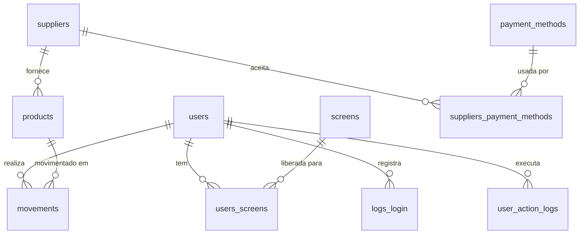

# Banco de dados

- **SGBD:** PostgreSQL 16, acessado com `pg` (SQL puro, sem ORM).
- **Schema:** migrations SQL numeradas em `back-end/src/database/migrations/`.
- **Modelo de referência:** `assets/estoque-diagram.drawio.png` (diagrama ER com nomes em português e tipos MySQL).

O diagrama é o **modelo planejado**. As tabelas implementadas usam nomes em inglês, snake_case e tipos do PostgreSQL. Este arquivo mostra cada tabela do diagrama ao lado do que existe hoje no código.

## 1. Resumo: diagrama × sistema

| Diagrama | Tabela no sistema | Branch onde existe | Situação |
|---|---|---|---|
| `usuario` | `users` | `users/backend` e derivadas | Implementada |
| `telas` | `screens` | `users/backend` e derivadas | Implementada |
| `usuario_tela` | `users_screens` | `users/backend` e derivadas | Implementada |
| `logsLogin` | `logs_login` | `users/backend` e derivadas | Implementada |
| `produto` | `products` | `products/backend` e derivadas | Implementada **sem** `idFornecedor` |
| `fornecedor` | `suppliers` | `suppliers/backend` | Implementada |
| `movimentacao` | `movements` | `movements/backend` | Implementada |
| `logsAcaoUsuario` | — | — | **Não implementada** |
| `formaPagamento` | — | — | **Não implementada** |
| `fornecedor_forma_pagamento` | — | — | **Não implementada** |

## 2. Relacionamentos



| Relação (diagrama) | Cardinalidade | No sistema |
|---|---|---|
| usuario → usuario_tela ← telas | N:N | `users_screens` (FKs com `ON DELETE CASCADE`) |
| usuario → logsLogin | 1:N | `logs_login.user_id` (CASCADE) |
| usuario → logsAcaoUsuario | 1:N | não implementada |
| usuario → movimentacao | 1:N | `movements.user_id` (CASCADE) |
| produto → movimentacao | 1:N | `movements.product_id` (CASCADE) |
| fornecedor → produto | 1:N | **falta** `products.supplier_id` |
| fornecedor → fornecedor_forma_pagamento ← formaPagamento | N:N | não implementada |

## 3. Tabelas implementadas

Colunas comuns a todas as tabelas do sistema (não existem no diagrama):
`created_at TIMESTAMPTZ NOT NULL DEFAULT NOW()` e, exceto em `users_screens` e `logs_login`, `updated_at TIMESTAMPTZ NOT NULL DEFAULT NOW()`.

### 3.1 `users` (diagrama: `usuario`) — migrations 001 e 002

| Coluna | Tipo no sistema | Diagrama | Diferença |
|---|---|---|---|
| `user_id` | `SERIAL PRIMARY KEY` | `id INT AUTO_INCREMENT PK` | — |
| `name` | `VARCHAR(150) NOT NULL` | `nome VARCHAR(150) NOT NULL` | — |
| `email` | `VARCHAR(255) NOT NULL UNIQUE` | `email VARCHAR(120) NOT NULL UNIQUE` | tamanho 255 × 120 |
| `password` | `VARCHAR(255) NOT NULL` | `senha VARCHAR(20) NOT NULL` | guarda o **hash bcrypt** (60 caracteres), por isso 255 |
| `salt` | `VARCHAR(255) NOT NULL` | `salt VARCHAR(255) NOT NULL` | — |
| `role` | `VARCHAR(20) NOT NULL DEFAULT 'user'` | — | só no sistema; valores `admin` / `user` |

Índice: `idx_users_email (email)`.

### 3.2 `screens` (diagrama: `telas`) — migration 001

| Coluna | Tipo no sistema | Diagrama | Diferença |
|---|---|---|---|
| `screen_id` | `SERIAL PRIMARY KEY` | `id INT AUTO_INCREMENT PK` | — |
| `name` | `VARCHAR(150) NOT NULL UNIQUE` | `nome VARCHAR(100) NOT NULL` | tamanho e `UNIQUE` só no sistema |
| `icon` | `VARCHAR(100) NOT NULL` | `icone VARCHAR(100)` (opcional) | no sistema é obrigatório |
| `redirect` | `VARCHAR(255) NOT NULL` | `redirecionamento VARCHAR(255) NOT NULL` | — |

Registros inseridos pela migration 001:

| name | icon (001) | icon (003_change_menu_icons*) | redirect |
|---|---|---|---|
| Dashboard | `dashboard` | `bar_chart_4_bars` | `/dashboard` |
| Produtos | `inventory` | `inventory_2` | `/products` |
| Fornecedores | `supplier` | `warehouse` | `/suppliers` |
| Movimentações | `movements` | `compare_arrows` | `/movements` |
| Usuários | `people` | `groups` | `/users` |

\* `003_change_menu_icons.sql` existe **apenas** na branch `products/frontend`. Ela troca os ícones por nomes válidos do Material Icons. Nas branches `*/backend` o número 003 é usado por outra migration (`003_seed_test_user.sql`).

### 3.3 `users_screens` (diagrama: `usuario_tela`) — migration 001

| Coluna | Tipo no sistema | Diagrama |
|---|---|---|
| `user_id` | `INTEGER NOT NULL` FK → `users(user_id) ON DELETE CASCADE` | `idUsuario INT NOT NULL FK` |
| `screen_id` | `INTEGER NOT NULL` FK → `screens(screen_id) ON DELETE CASCADE` | `idTela INT NOT NULL FK` |

PK composta `(user_id, screen_id)`, igual ao diagrama. Índices: `idx_users_screens_user_id` e `idx_users_screens_screen_id`.
Define **quais telas o usuário pode acessar**. Ter a tela libera ver e editar tudo nela (ver `geral/autenticacao-e-permissoes.md`).

### 3.4 `logs_login` (diagrama: `logsLogin`) — migration 004

| Coluna | Tipo no sistema | Diagrama |
|---|---|---|
| `log_id` | `SERIAL PRIMARY KEY` | `id INT AUTO_INCREMENT PK` |
| `user_id` | `INTEGER NOT NULL` FK → `users(user_id) ON DELETE CASCADE` | `idUsuario INT NOT NULL FK` |
| `date_time_login` | `TIMESTAMPTZ NOT NULL DEFAULT NOW()` | `dataHora DATETIME NOT NULL` |

Índice: `idx_logs_login_user_id`. Uma linha é gravada a cada login bem-sucedido (`authService`).

### 3.5 `products` (diagrama: `produto`) — migrations 005 e 006

| Coluna | Tipo no sistema | Diagrama | Diferença |
|---|---|---|---|
| `product_id` | `SERIAL PRIMARY KEY` | `id INT AUTO_INCREMENT PK` | — |
| `name` | `VARCHAR(150) NOT NULL` | `nome VARCHAR(150) NOT NULL` | — |
| `quantity` | `INTEGER NOT NULL` | `quantidade INT NOT NULL` | — |
| `unit` | `VARCHAR(20)` | `unidade VARCHAR(20)` | — |
| `unit_price` | `DECIMAL(10,2)` | `precoUnit DECIMAL(10,2)` | — |
| `category` | `VARCHAR(100)` | `categoria VARCHAR(100)` | — |
| `expiration_date` | `DATE` | `validade DATE` | — |
| `product_image` | `TEXT` | `imagemProd MEDIUMTEXT` | `TEXT` é o equivalente no PostgreSQL |
| — | — | `idFornecedor INT NOT NULL FK → fornecedor(id)` | **falta no sistema** |

Índice: `idx_products_category`.
Seed (006): 8 produtos de exemplo (Arroz, Feijão, Açúcar, Óleo, Café, Leite, Detergente, Papel Higiênico), sem fornecedor.

### 3.6 `suppliers` (diagrama: `fornecedor`) — migrations `007_create_supliers.sql` e `008_seed_suppliers.sql` (branch `suppliers/backend`)

| Coluna | Tipo no sistema | Diagrama | Diferença |
|---|---|---|---|
| `supplier_id` | `SERIAL PRIMARY KEY` | `id INT AUTO_INCREMENT PK` | — |
| `name` | `VARCHAR(150) NOT NULL` | `empresa VARCHAR(150) NOT NULL` | nome da coluna |
| `contact` | `VARCHAR(20) NOT NULL` | `contato VARCHAR(20) NOT NULL` | — |
| `cnpj` | `VARCHAR(20) NOT NULL` | `cnpj VARCHAR(20) NOT NULL` | — |
| `category` | `VARCHAR(100) NOT NULL` | `categoria VARCHAR(20)` (opcional) | tamanho 100 × 20; obrigatório no sistema |

Índice: `idx_suppliers_category`.
Seed (008): Atack (Alimentício), Infostore (Eletrônicos), Concorde (Papelaria).

### 3.7 `movements` (diagrama: `movimentacao`) — migration `007_create_movements.sql` (branch `movements/backend`)

| Coluna | Tipo no sistema | Diagrama | Diferença |
|---|---|---|---|
| `movement_id` | `SERIAL PRIMARY KEY` | `id INT AUTO_INCREMENT PK` | — |
| `quantity` | `INTEGER NOT NULL` | `quantidade INT NOT NULL` | — |
| `direction` | `VARCHAR(20) NOT NULL` | `entradaSaida VARCHAR(20) NOT NULL` | valores `in` (entrada) / `out` (saída), validados pelo Joi |
| `status` | `VARCHAR(50)` | `status VARCHAR(50)` | — |
| `user_id` | `INTEGER NOT NULL` FK → `users(user_id) ON DELETE CASCADE` | `idUsuario INT NOT NULL FK` | — |
| `product_id` | `INTEGER NOT NULL` FK → `products(product_id) ON DELETE CASCADE` | `idProduto INT NOT NULL FK` | — |

Índices: `idx_movements_user_id` e `idx_movements_product_id`.

## 4. Tabelas do diagrama ainda não implementadas

O SQL abaixo é uma **proposta** que segue os padrões do sistema. Ele ainda não existe em nenhuma migration. Nomes, `ON DELETE` e obrigatoriedade precisam ser confirmados antes de virar migration.

### 4.1 `products.supplier_id` (diagrama: `produto.idFornecedor`)

```sql
ALTER TABLE products
    ADD COLUMN IF NOT EXISTS supplier_id INTEGER REFERENCES suppliers (supplier_id) ON DELETE RESTRICT;

CREATE INDEX IF NOT EXISTS idx_products_supplier_id ON products (supplier_id);
```

No diagrama a coluna é `NOT NULL`. Só dá para aplicar `NOT NULL` depois de preencher o fornecedor dos 8 produtos do seed 006, que hoje não têm fornecedor. Depende da tabela `suppliers`, então a migration precisa ter número maior que a de suppliers.

### 4.2 `user_action_logs` (diagrama: `logsAcaoUsuario`)

| Diagrama | Proposta |
|---|---|
| `id INT AUTO_INCREMENT PK` | `log_id SERIAL PRIMARY KEY` |
| `acao VARCHAR(20) NOT NULL` | `action VARCHAR(20) NOT NULL` (ex.: `create`, `update`, `delete`) |
| `entidade VARCHAR(100) NOT NULL` | `entity VARCHAR(100) NOT NULL` (ex.: `products`) |
| `idEntidade INT NOT NULL` | `entity_id INTEGER NOT NULL` |
| `dataHora DATETIME NOT NULL` | `date_time_action TIMESTAMPTZ NOT NULL DEFAULT NOW()` |
| `idUsuario INT NOT NULL FK` | `user_id INTEGER NOT NULL REFERENCES users (user_id) ON DELETE CASCADE` |

`entity` + `entity_id` formam uma **referência lógica**, como no diagrama: não há FK, porque a linha pode apontar para qualquer tabela.

### 4.3 `payment_methods` (diagrama: `formaPagamento`)

| Diagrama | Proposta |
|---|---|
| `id INT AUTO_INCREMENT PK` | `payment_method_id SERIAL PRIMARY KEY` |
| `nome VARCHAR(25) NOT NULL UNIQUE` | `name VARCHAR(25) NOT NULL UNIQUE` |

Valores fixos (seed): `pix`, `boleto`, `credito`, `debito`.

### 4.4 `suppliers_payment_methods` (diagrama: `fornecedor_forma_pagamento`)

| Diagrama | Proposta |
|---|---|
| `idFornecedor INT NOT NULL FK` | `supplier_id INTEGER NOT NULL REFERENCES suppliers (supplier_id) ON DELETE CASCADE` |
| `idFormaPagamento INT NOT NULL FK` | `payment_method_id INTEGER NOT NULL REFERENCES payment_methods (payment_method_id) ON DELETE CASCADE` |
| `PRIMARY KEY (idFornecedor, idFormaPagamento)` | `PRIMARY KEY (supplier_id, payment_method_id)` |

## 5. Migrations existentes

| Nº | Arquivo | Branch | O que faz |
|---|---|---|---|
| 001 | `001_init.sql` | todas com back-end | Cria `users`, `screens`, `users_screens` e insere as 5 telas |
| 002 | `002_add_user_role.sql` | todas com back-end | Adiciona `users.role` e promove `ADMIN_EMAIL` a admin |
| 003 | `003_seed_test_user.sql` | `users`, `products`, `suppliers`, `movements` /backend | Cria o usuário `teste@teste.com` com a tela Dashboard |
| 003 | `003_change_menu_icons.sql` | `products/frontend` | Troca os ícones das telas por nomes do Material Icons |
| 004 | `004_create_logs_login.sql` | `users/backend` e derivadas | Cria `logs_login` |
| 005 | `005_create_products.sql` | `products/backend` e derivadas | Cria `products` |
| 006 | `006_seed_products.sql` | `products/backend` e derivadas | Insere 8 produtos |
| 007 | `007_create_supliers.sql` | `suppliers/backend` | Cria `suppliers` (o nome do arquivo tem o erro de digitação "supliers") |
| 008 | `008_seed_suppliers.sql` | `suppliers/backend` | Insere 3 fornecedores |
| 007 | `007_create_movements.sql` | `movements/backend` | Cria `movements` |

**Conflitos de numeração ao juntar branches:**
- `007`: `suppliers/backend` × `movements/backend`.
- `003`: `003_seed_test_user.sql` (backend) × `003_change_menu_icons.sql` (`products/frontend`).

Uma das migrations de cada par precisa ser renumerada para o próximo número livre. As migrations rodam em **ordem alfabética do nome do arquivo**, então quem tem FK precisa vir depois da tabela referenciada.

## 6. Como as migrations rodam

- `server.js` chama `runMigrations()` a cada inicialização. Ela executa **todos** os `.sql` da pasta em ordem alfabética. Não existe tabela de controle de migrations já executadas.
- Antes de cada arquivo, define `app.admin_email` na sessão, que a migration 002 usa.
- No Docker, `docker-compose.yml` monta a pasta `migrations/` em `/docker-entrypoint-initdb.d`. Assim, o Postgres também executa os arquivos quando o volume é criado.
- Execução manual: `npm run migrate`.

Por isso **toda migration precisa ser idempotente**, ou seja, pode rodar várias vezes sem erro.

## 7. Regras para novas migrations

1. Nome `NNN_descricao_em_ingles.sql`, usando o próximo número livre **em todas as branches**.
2. Nunca edite uma migration existente. Crie uma nova.
3. Use `CREATE TABLE IF NOT EXISTS`, `ADD COLUMN IF NOT EXISTS`, `CREATE INDEX IF NOT EXISTS`. Nos seeds, use `ON CONFLICT DO NOTHING` ou `WHERE NOT EXISTS`.
4. Tabelas no plural, em snake_case e em inglês. A PK é `<singular>_id SERIAL PRIMARY KEY`.
5. Inclua `created_at` e `updated_at` como `TIMESTAMPTZ NOT NULL DEFAULT NOW()`.
6. Toda FK tem `ON DELETE` explícito e um índice (`idx_<tabela>_<coluna>`).
7. Não coloque dados sensíveis reais em seeds.
8. Quando implementar algo do diagrama, atualize as seções 1, 3 e 4 deste arquivo.

## 8. Seeds em código (`src/database/seed.js`)

Rodam a cada inicialização, depois das migrations, e não duplicam registros:

| Usuário | Senha | Role | Telas |
|---|---|---|---|
| `ADMIN_EMAIL` (padrão `admin@admin.com`) | `ADMIN_PASSWORD` (padrão `Admin@123`) | `admin` | todas |
| `teste@teste.com` | `Teste@123` | `user` | Dashboard |

O usuário de teste também é criado pela migration 003. Não há duplicação porque as duas verificam se o e-mail já existe.
